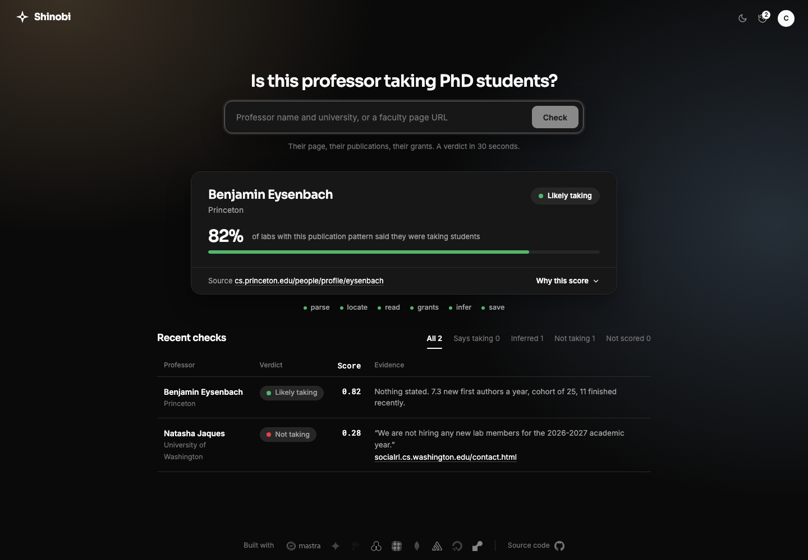
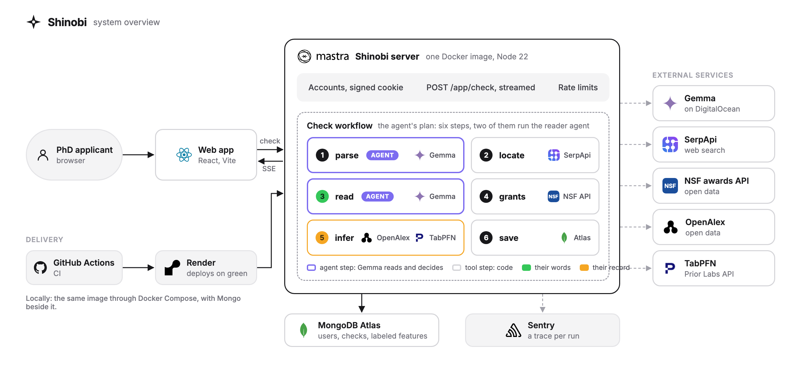

# Shinobi

[](https://github.com/sudiptob2/shinobi/actions/workflows/ci.yml)
[](LICENSE)
[](package.json)
[](compose.yaml)
[](https://render.com/deploy?repo=https://github.com/sudiptob2/shinobi)

**An agent that checks whether a professor is taking PhD students, before you email them.**
Type a name and a university, or paste a faculty page.
Thirty seconds later you have the professor's own words if they said anything, a score from their publication record either way, and a plain-language reason for both.

Live at https://askshinobi.tech



## The problem

Applying to a PhD means emailing professors.
Most applicants send twenty or more messages and hear back from two or three.
The usual advice is to write better emails, but the bigger reason is upstream: a large share of any shortlist is professors who are not taking students this cycle.
Their page does not say so, or it says "I am always looking for students" and was last touched in 2021, or it says "recruiting" and means one student who was already chosen.
The applicant has no way to tell, so they email everyone, and the professors who are actually recruiting are buried under the same pile.

I labeled 59 machine learning professors at US and Canadian universities by hand to see how bad this is.
Reading every faculty page and every lab page took a day.

| What the pages said | Professors |
|---|---|
| Taking students, in so many words | 30 |
| Not taking students | 4 |
| Nothing at all | 25 |

Almost half said nothing.
Of the 30 who said yes, several had a note that was years old, and several more had a publication record that did not look like a group with open seats.
That is the gap Shinobi is built for: it does the day of reading in thirty seconds, and it does not stop at what the page says.

## What Shinobi does

For one professor, the agent:

1. finds the right page from a name and a school, skipping aggregator sites and namesakes;
2. reads the page and the lab pages behind it, and reports whether the professor states a recruiting status, quoting the exact sentence and the page it came from;
3. throws the statement out if it is for a past admissions cycle or dated more than a year ago, and says so;
4. looks up the professor's NSF awards, because a grant that started this year funds a student next year and no page ever mentions it;
5. pulls the professor's publication record and turns it into ten features about how many new students the group takes and how many finish;
6. scores that record with TabPFN, a tabular foundation model fit on the hand-labeled professors, and explains the score sentence by sentence against the labeled groups;
7. combines both signals into one label, and refuses to score when the data would mislead.

Every step shows in the interface as it runs, with what it found.

The labels a student sees:

| Label | Meaning |
|---|---|
| Taking students | the page says yes and the record agrees |
| Says taking, slower intake | the page says yes, the record looks like a group that takes fewer students than it says |
| Says taking, rarely does | the page says yes, the record looks like a group that has not taken students in a while |
| Says taking, unverified | the page says yes and the record could not be scored |
| Not taking | the page says no, which overrides everything |
| Likely taking, Toss-up, Unlikely | the page says nothing; the record alone, at over 60%, 40 to 60%, or under 40% |
| Not scored | the page says nothing and the record cannot be trusted; the reason is shown |

The second row is the case this project exists for.
A page that says "taking students" is not always current, and a student deserves to know when the numbers disagree with the words.

## How the agent works



The check is a [Mastra](https://mastra.ai) workflow with six steps.
The plan is fixed, which is deliberate: a student should get the same kind of answer every time, and a fixed plan is what makes the trace in the interface meaningful.
The judgment lives inside the steps, in the model that reads the pages, in the rules about which links to follow, and in the refusals.

### Where the agent is

There is one agent, the **reader**, a Mastra `Agent` running Gemma through any OpenAI-compatible host.
Two of the six steps hand it a task and act on what it returns:

- In **parse** it reads whatever the student typed and decides which words are the person and which are the institution, including nicknames and short forms, and ignores titles and degrees.
- In **read** it is given up to six pages of text and has to decide whether the professor states a recruiting status at all, which single sentence is the decisive one, which page it is on, and what date, if any, is printed next to it.
  It must tell a real statement apart from headings, invitations to apply, conditionals, notes about postdocs, and notes about past cycles.
  It answers in a fixed JSON shape, is retried on provider errors, and its answer is checked by code before it is trusted: a statement for a past cycle is overruled and reported as stale.

The other four steps are tools, deterministic code with no model in the loop: search and page fetching with their scoring rules, the NSF lookup, the feature computation, the TabPFN call, and the sentence-by-sentence explanation.
That split is on purpose.
The model does the two things that need reading comprehension, and everything that can be checked, tested or reproduced is done without it.
The workflow is the agent's plan: the same six steps every time, each one visible in the interface as it runs, each one able to refuse with a reason instead of guessing.

### The components

**Query parser** (`tools/gemma.ts`, step 1).
Gemma turns whatever was typed into a person and an institution: "prof. anwar haque uwo" becomes Anwar Haque at UWO, and a short form like UWO, MIT or CMU is expanded to the full name so the later lookups can match it.
Titles and degrees are stripped.

**Locator** (`tools/serpapi.ts`, step 2).
Two search queries through SerpApi, the quoted name with the school and then the name with "professor".
Results must contain every token of the name.
Academic hosts and titles that read as a faculty page score highest; LinkedIn, ResearchGate, people-search sites and publisher pages are never followed.
If only a Google Scholar profile surfaces, the agent reads it and takes the homepage it lists, provided the name and school agree.

**Page reader** (`tools/page.ts`, step 3).
Fetches the page, converts it to text, and keeps the passages around student-related keywords so a long page still fits.
It then follows up to five links that look like they could carry a recruiting note: "prospective students", "join the lab", "openings", and off-site links only when they look like the professor's own lab and the target page mentions their name.
A lab site on another host gets one more hop for its join or contact page.

**Reader model** (`tools/gemma.ts`, step 3).
Gemma, through any OpenAI-compatible host, reads the collected pages and returns one JSON object: a status, the decisive sentence copied verbatim, which page it came from, and any date printed next to it.
The prompt is strict about what does not count: headings, menu items, invitations to apply, conditionals, anything about postdocs or master's students, and anything naming a past cycle.
Staleness is then decided in code, not by the model: a statement for a cycle that already started, or dated more than a year ago, becomes "unstated" with a note that says what was found and why it was ignored.

**Grants** (`tools/grants.ts`, step 4).
The NSF awards API, keyless, queried by principal investigator name and filtered to the professor's institution.
Awards under $50,000 are ignored as travel or workshop money.
Two features come out: active awards, and months since the latest one started.
The explanation says when an award is recent enough to fund a student in the next cycle, and says plainly that NSERC and NIH are not checked.

**Record scorer** (`tools/openalex.ts` and `tools/tabpfn.ts`, step 5).
OpenAlex supplies every paper since 2008 with its author list.
From that come the features: new first authors per year and their trend, the cohort of junior coauthors still active, how many finished recently, papers per year and their trend, career length, years since the last paper, plus the two grant features.
TabPFN, the Prior Labs tabular foundation model, is fit once on the labeled professors and returns the probability that a group with this record is taking students.
Three refusals guard it: a field that lists authors alphabetically carries no first-author signal; an author with under five papers has no record to score; a name that matches several OpenAlex authors, or none at the given school, is not guessed.

**Explainer** (`tools/explain.ts`, step 5).
Deterministic sentences, one per driver, each comparing a feature with the medians of the labeled recruiting and not-recruiting groups.
Dormancy comes first because it overrides everything.
The closing sentence reconciles the page with the score, for example "the page says yes, but only 31% of labs that publish like this were taking students; the note may be old or aspirational".
Because the text is built from the features rather than generated, it is testable and it never contradicts the number.

**Verdict** (`verdict.ts` and `web/src/verdict.ts`).
One schema for every outcome, whether stated, inferred or not scored, so the interface and the history never see a special case.
The web app combines the two signals into the label table above.

**Server** (`index.ts`).
Email and password accounts with a signed cookie, a check route that streams each step's start and result as server-sent events and then the verdict, and three rate limits: per user, per address on sign-in, and a global daily cap that protects the shared search quota from throwaway accounts.
The built web app is served from the same process.

**Storage and observability.**
MongoDB Atlas holds users, checks, the labeled feature table that TabPFN learns from, and Mastra's own workflow state.
Sentry receives a trace for every run through Mastra's exporter, so a slow or failed step can be seen step by step.

### Why open parts matter here

Every component is replaceable by configuration, and that is not an accident.
The reader is any OpenAI-compatible endpoint, so it has run on Google AI Studio, on a self-hosted Gemma and on a proxy during development without a code change.
The labeled table is two CSV files anyone can extend with a careful hour of reading.
The features are documented numbers, not embeddings, so the explanation can be checked by a human.
OpenAlex and the NSF API are open data; the agent would be impossible on closed bibliographic databases.
TabPFN replaces a model that would otherwise need thousands of labels; with 59 it gives a calibrated probability and a leave-one-out estimate.

### What the numbers say

`npm run batch` runs the check over the labeled shortlist and reports agreement between the reader and the hand labels.
In the last run the reader agreed with the hand label for 50 of 59 professors.
The misses are mostly pages whose recruiting note lives on a page the locator did not reach, which is the next thing to improve.

## Built with

Mastra (workflow, agent and server), Gemma (query parsing and page reading), TabPFN by Prior Labs (scoring), OpenAlex (publications), the NSF awards API (grants), SerpApi (search), MongoDB Atlas (accounts, checks, workflow state), Sentry (traces), Render (hosting), Docker (local and production parity), GitHub Actions (CI).

## Run it locally

You need Docker and the keys below.

```
git clone https://github.com/sudiptob2/shinobi && cd shinobi
cp .env.example .env            # fill in the keys
docker compose up --build       # Mongo, then the app on http://localhost:4111
```

The first start also fills the labeled table that TabPFN learns from, by pulling OpenAlex and NSF data for the 76 labeled professors.
That takes a couple of minutes and shows in the `seed` service's log; later starts skip it.
To pull the table again, for example after editing the CSVs, run `docker compose run --rm seed npm run features -- --refresh`.

Create an account in the app and check a professor.

### Keys

| Variable | Needed for | Where |
|---|---|---|
| `SERPAPI_API_KEY` | finding the page | https://serpapi.com, free tier is enough |
| `PRIORLABS_API_KEY` | TabPFN scoring | https://priorlabs.ai |
| `GEMMA_BASE_URL`, `GEMMA_API_KEY`, `GEMMA_MODEL` | reading the page | any OpenAI-compatible server hosting Gemma, or Google AI Studio when the base URL is empty |
| `SESSION_SECRET` | signing the login cookie | `openssl rand -hex 32` |
| `OPENALEX_API_KEY` | optional, lifts the unkeyed OpenAlex rate limit | https://openalex.org |
| `SENTRY_DSN` | optional, traces every run | https://sentry.io |

### Hot reload

For day-to-day work, run Mongo in Docker and the app on your machine.

```
docker compose up mongo seed    # Mongo, with the labeled table filled
npm install && npm install --prefix web
npm run dev                     # the Mastra server on http://localhost:4111
npm run build --prefix web      # rebuild the web app after changing it; the server serves web/dist
```

`npm run dev --prefix web` gives you a Vite dev server with hot reload on port 5173 that proxies `/app` to the Mastra server.

### Checks

```
npm test                        # unit tests for the reader, features, grants, verdict labels
npm run typecheck
npm run lint --prefix web
npm run batch                   # runs the workflow over the labeled shortlist and reports agreement with the hand labels
```

## Deploying

CI runs on every push and pull request: typecheck, tests, lint, the web build and a Docker build.
Render watches `main` with auto-deploy set to "after CI checks pass", so a commit is built from the same Dockerfile only once those checks are green.

To set it up once:

1. In Render, connect your GitHub account, then create the web service from this repo with the Docker runtime and the variables in `.env.example`. `render.yaml` is a Blueprint that declares the same service, including the auto-deploy setting.
2. Allow Render's outbound IPs in the MongoDB Atlas network access list.

The image also runs anywhere else that takes a Dockerfile.
It listens on `PORT`, default 4111, and needs the same variables as `.env.example`.

## Layout

```
src/mastra/
  workflow.ts           the six steps
  verdict.ts            the one output type
  index.ts              the server: Mastra config, auth routes, the check as a server-sent event stream, the web app
  auth.ts               email and password accounts, signed cookie sessions
  db.ts                 Mongo collections: users, checks, features, models
  tools/                serpapi, page, gemma, grants, openalex, tabpfn, explain, text
web/                    the React app (Vite)
scripts/features.ts     OpenAlex and NSF features for the labeled table into Mongo
scripts/batch.ts        runs the workflow over the shortlist and scores it against the hand labels
data/                   the hand-labeled shortlist and the not-recruiting negatives
docs/                   the screenshot and the architecture diagram, with its HTML source
```

## The labeled data

Fifty-nine ML professors at US and Canadian universities, picked from last authors of NeurIPS 2024 and 2025 papers in OpenAlex, at most three per school, weighted toward early career, plus seventeen professors who state they are not taking students.
Each one's faculty and lab pages were read by hand on 2026-10-13 and the recruiting statement, if any, was copied verbatim with its URL.
A statement dated before 2025 counts as unstated.
The two CSV files in `data/` are the whole dataset, and adding a careful label is the most valuable contribution this project can get.

## Contributing

Pull requests are welcome.
[CONTRIBUTING.md](CONTRIBUTING.md) has the setup, the checks to run, the commit style and how to add a label.

## Limitations

Alphabetical author order carries no first-author signal, so those professors are not scored.
Publication lag means current intake is never directly observable; the claim is capacity, never an open slot.
OpenAlex author matching is imperfect for common names.
Only NSF grants are checked; NSERC and NIH are not, and the explanation says so for Canadian labs.
Search results vary between runs, so the same professor can resolve to a different page on a second check.
The labeled set is machine learning only; other fields publish differently and would need their own labels.
Nothing is ever emailed on your behalf.

## License

Apache License 2.0. See [LICENSE](LICENSE).

Built for the DEV.to Hacktoberfest Open-Source AI Challenge 2026.
