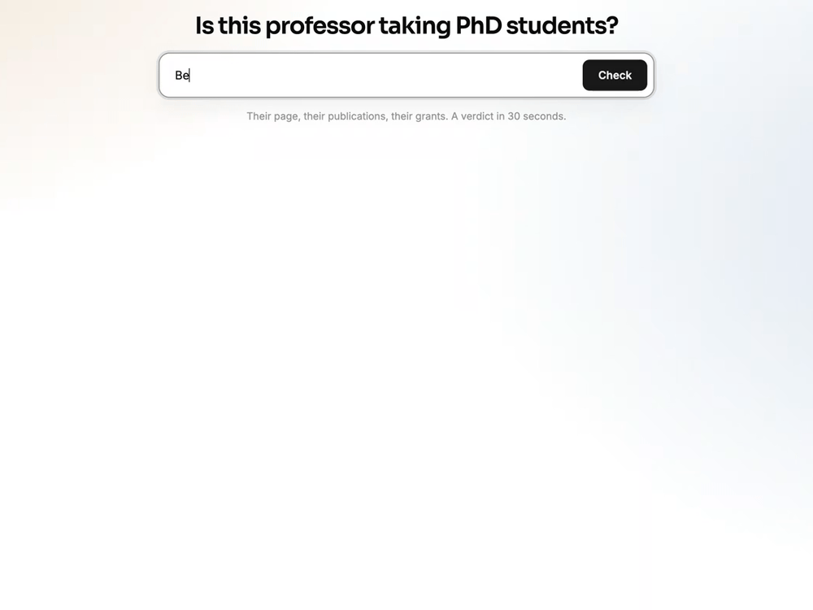
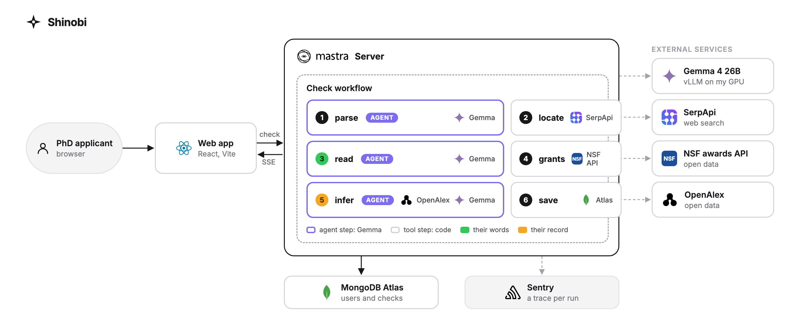

# Shinobi

[](https://github.com/sudiptob2/shinobi/actions/workflows/ci.yml)
[](LICENSE)
[](compose.yaml)
[](https://render.com/deploy?repo=https://github.com/sudiptob2/shinobi)

**Shinobi tells you whether a professor is really taking PhD students, before you email them.** Type a name and a university. About thirty seconds later you get the professor's own words if they said anything, a score based on their publication record either way, and the reasons behind both.

Live at [https://askshinobi.tech](https://askshinobi.tech)



## Why

A friend of mine is applying for a PhD.
She made a list of professors whose work she liked and emailed them one by one.
**Most of them never replied.**
She asked me for help, because I had been through the same thing for my Master's and had come out of it with scholarships.
So we sat down with her list.
Many of those professors were simply **not taking new students that year**.
Some of their pages said nothing about it.
Some said "I am always looking for students", but the note was *3 or 4 years old*.
There was *no way to know* before sending the email.

That made me think this is something **every prospective student runs into**.
We all spend weeks writing to people who were never going to say yes, and the professors who are actually recruiting get lost in the same pile.

To check how common it is, I read the faculty and lab pages of 60 machine learning professors by hand.
31 said they were taking students, 4 said they were not, and **25 said nothing at all**.
Even among the 31 who said yes, several had old notes, and several more had a publication record that did not look like a group with room for new students.

So I built Shinobi.
It is an AI agent that does the checking for you: it finds the professor's page, reads what it says and *how old it is*, looks up their recent grants, and studies their publication record for signs of a group that takes students, such as how many new first authors appear each year and how many students have finished recently.
It puts all of that together into **one verdict**, with the professor's own words and the numbers behind it, so you know who is worth an email *before you write it*.

## How it works



A check is a [Mastra](https://mastra.ai) workflow with six steps.
Three of the steps are run by an **agent** built on Gemma, served from any OpenAI-compatible endpoint; in production it is Gemma 4 26B on my own GPU through vLLM.
The other three are ordinary code.

1. **parse** (agent): turns what you typed into a person and a university.
2. **locate**: searches with SerpApi for the faculty or lab page, preferring university sites and skipping aggregator sites.
3. **read** (agent): fetches the page and its lab pages, then the reader answers four questions: is there a recruiting statement, *what exactly does it say*, which page is it on, and when was it written.
  A statement about a past admissions cycle is marked as *stale* and ignored.
4. **grants**: counts the professor's active NSF awards and checks how recent the latest one is.
5. **infer** (agent): turns the publication record from OpenAlex into ten numbers, such as how often the professor is last author and how many students at their own institution are publishing with them, asks Gemma for a probability from those numbers alone, and writes the explanation from the same numbers in code, so *the words can never disagree with the score*.
6. **save**: stores the verdict in your history.

The two signals, **what the page says** and **what the record says**, are combined into one label: *Taking students*, *Says taking but slower intake*, *Says taking but rarely does*, *Not taking*, *Likely*, *Toss-up*, *Unlikely*, or *Not scored* with the reason.

Around the workflow there is a React front end that shows each step as it runs, accounts and rate limits, MongoDB Atlas for users, checks and the labeled data, and a Sentry trace for every run.
Everything ships as **one Docker image**: the same image runs locally with Compose and in production on Render, deployed from `main` once CI passes.

In the last batch run, the reader agreed with my hand labels for **51 of 60** professors.

## Run it

```
cp .env.example .env            # SerpApi and Gemma keys
docker compose up --build       # http://localhost:4111
```

For development, run `docker compose up mongo` and then `npm run dev`.
To check your changes: `npm test`, `npm run typecheck`, `npm run lint --prefix web`, then `npm run batch` to score the reader and `npm run judge` to score the record judge, both against the hand labels.

Contributions are welcome; see [CONTRIBUTING.md](CONTRIBUTING.md).

## License

Apache 2.0.